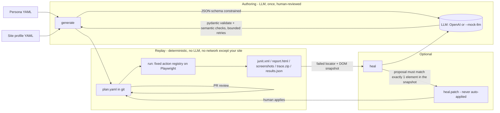

# journeyprobe

[](https://github.com/baggy2797/journeyprobe/actions/workflows/ci.yml)

An LLM **authors** persona-based user-journey tests as a reviewable YAML plan. Playwright **replays** that plan
deterministically, with no LLM involved at run time. When a locator breaks, an optional `heal` command asks the LLM for a
replacement based on a DOM snapshot and gives it to you as a **diff that is never applied automatically**.

The point is to use an LLM where it is good (turning "Maya, a budget-conscious student, wants a mug" into test steps)
and keep it out of where it hurts (CI runs that must be fast, cheap, repeatable and diffable).

```yaml
# examples/plans/maya-fixture-shop.plan.yaml (generated, then reviewed like any other code)
journeys:
- name: 'maya: Buy a ceramic mug'
  goal: Buy a ceramic mug
  steps:
  - {action: goto, path: /}
  - {action: search, query: Mug}
  - {action: click, target: {role: link, name: Ceramic Mug}}
  - {action: add_to_cart}
  - {action: assert_text, text: Added to cart}
  - {action: click, target: {testid: cart-link}}
  - {action: assert_text, text: Ceramic Mug, target: {testid: cart-items}}
```

## Architecture



## Quickstart (no API key, no network)

```bash
pip install -e ".[dev]"            # Python 3.10+
playwright install chromium

journeyprobe demo-shop &           # bundled static shop on http://127.0.0.1:8431

journeyprobe generate --persona examples/personas/maya.yaml \
                      --site examples/sites/fixture-shop.yaml \
                      --out plan.yaml --mock-llm
journeyprobe validate plan.yaml --site examples/sites/fixture-shop.yaml
journeyprobe run plan.yaml --site examples/sites/fixture-shop.yaml --out-dir jp-report
```

With a real model, drop `--mock-llm` and set `OPENAI_API_KEY` (`pip install 'journeyprobe[openai]'`, `--model` to choose).
The key is read from the environment only and is never written anywhere.

When something breaks:

```bash
journeyprobe heal plan.yaml --site site.yaml --report-dir jp-report --out heal.patch   # add --mock-llm to stay offline
patch -p1 < heal.patch        # only after you have read it
```

`run` exits 1 if any journey fails, so it composes with CI. Outputs in `--out-dir`: `junit.xml` (one `testcase` per
journey, stable names), `report.html`, `results.json`, and for failed journeys a full-page screenshot, a trimmed DOM
snapshot and a Playwright `trace.zip` (`playwright show-trace`).

A failed journey's `<failure type=...>` is the real error class of the failing step: `TimeoutError` (Playwright waited too
long), `AssertionError` (an `assert_*` step), `StepError` (journeyprobe refused, e.g. to leave the site origin) or
`PlaywrightError`. The `message` is unchanged (`step N (action): ...`). Flaky-test tools can key on the type; the same
value is `error_type` in `results.json`. Results written by older versions have no `error_type` and keep `StepFailed`.

### GitHub Action

```yaml
- uses: baggy2797/journeyprobe@v1   # requires the repo to be published and tagged v1 (not yet done)
  with:
    plan: tests/journeys/maya.plan.yaml
    site: tests/journeys/site.yaml
    base-url: ${{ steps.deploy.outputs.preview_url }}
```

### Docker

```bash
mkdir -p jp-report && chmod 777 jp-report
docker compose up --build --abort-on-container-exit --exit-code-from probe
```

Based on `mcr.microsoft.com/playwright/python` (tag pinned to the pinned `playwright` version).

## The action vocabulary

Fixed and enforced by schema: `goto`, `search`, `click`, `fill`, `add_to_cart`, `assert_text`, `assert_visible`,
`assert_url`. Locators are structured (`testid`, `role`+`name`, `text`, `label`, `css`, optional `nth`), never free-form
code. The model cannot emit anything the runner does not already know how to do, and `goto` cannot leave the site's host.
Adding an action is a model class plus a handler in `actions.py`; a test fails if the two sets drift apart.

`search` and `add_to_cart` take their locators from the **site profile** (`selectors:`), so a site-wide change is fixed in one
place and `heal` knows whether to patch the plan or the profile.

## Design decisions

- **Plan as the artifact.** The YAML is canonical, diffable, reviewable in a PR, and the thing CI executes. Regenerating
  is an explicit act, not something that happens on every run.
- **Schema, not parsing.** The model is asked for JSON matching the pydantic-derived JSON schema; output is validated
  with pydantic (`extra=forbid`, discriminated union on `action`) plus semantic checks against the profile. Failures are
  fed back for up to 3 attempts. No regex over model text.
- **No LLM import on the replay path.** `runner.py` and `actions.py` do not touch the LLM layer.
- **Heal is advisory and verified.** The proposal is loaded into the saved DOM snapshot and rejected unless the locator
  matches exactly one element. Output is a unified diff; the tool never writes to your plan or profile. The snapshot is
  untrusted page content and the prompt says so.
- **Mock LLM is a first-class mode**, so every test and CI run is offline and deterministic. It is a rule-based stand-in
  (token overlap between goals and `known_items`), not a model.
- **Provider-agnostic.** `LLM` is a one-method protocol (`complete_json`); OpenAI, a recorded-response replayer and the mock implement it.

## Tests

`pytest` runs 35 tests: unit (schema, action registry, planner with recorded fixtures including repair-retry, reporting,
CLI) and integration (real Chromium against the fixture shop served from a pytest fixture on a free port; includes a
broken-selector scenario, artifact checks, heal end-to-end and applying the generated patch). Coverage gate: 80%
(`--cov-fail-under` in `pyproject.toml`). No test touches a live site or needs a key.

## Limitations (read these)

- **The OpenAI path is untested against the live API.** Its request/response handling is covered with a fake client only.
  I use `json_schema` with `strict: false` because the discriminated-union schema is not guaranteed to satisfy strict
  mode; the pydantic validation and retry loop is the real safety net. Plan quality with real models is unmeasured.
- **The mock does not "understand" anything.** Its plan shape is hard-wired to a shop-like flow (search, open product,
  add, check cart). The fixture shop is a toy; this has not been run on any real or third-party site.
- **Chromium only**, desktop viewport, no auth/login flows, no secrets handling, no iframes/shadow-DOM-specific support
  beyond what Playwright's locators do by default.
- **Site confinement is best effort, not a sandbox.** A network-layer guard aborts off-origin navigations and vets every
  redirect hop, service workers are blocked, and every step is followed by an origin check. It assumes the site under test
  is trusted. A same-origin server that answers a redirect differently the second time can still make the browser send one
  request elsewhere (the run then fails, but the request was made). For hostile sites, run in a container with an egress
  allow-list.
- **Private-network protection is relaxed for private targets only.** When the site under test resolves entirely to
  private, loopback or link-local addresses (Docker, staging, localhost), Chromium's Private Network Access checks are
  turned off for that run, because the redirect guard serves pages itself and they would otherwise be treated as public
  and lose their own scripts. A page on such a target can therefore reach other private services. For a public target, or
  a host that does not resolve or has any public address, the checks stay on. The browser is pinned to the checked
  address and the host is re-resolved before every document fetch (aborting on any change); a very small race window
  between that check and the fetch remains, which needs hostile DNS for a host you chose to test.
- **Vocabulary is e-commerce flavoured** and deliberately small. Assertions are text/visibility/URL only.
- **Heal handles locator failures only**; it does not fix wrong expectations, changed flows or timing issues, and it
  heals one failure per journey (steps after the first failure are skipped).
- **Healing/diffs assume canonical YAML.** Files written by `generate` are canonical; hand-formatted files may need manual patching (the CLI warns).
- **Not verified:** the Dockerfile and docker-compose (Docker was not available when this was built), and the GitHub
  workflows and composite action have never run on GitHub (YAML parses; actions are pinned to SHAs looked up via `gh api`).
  Release to PyPI/GHCR needs a configured Trusted Publisher and a `pypi` environment.
- `ruff format` is not enforced.

## Comparison

This is my understanding of other tools from their public docs, not a benchmark; check their current docs.

| | journeyprobe | Playwright MCP | Stagehand | browser-use |
|---|---|---|---|---|
| What the LLM does | Writes a test plan once, offline | Drives a live browser through tool calls | Interprets natural-language `act/extract/observe` calls in your code | Runs an agent loop toward a task |
| LLM at test run time | **No** | Yes | Yes (can cache) | Yes |
| Main artifact | Reviewable YAML in git | None (it is an interface for an agent) | Scripts using its SDK | Agent runs / scripts |
| Primary use | Regression tests in CI | Letting an agent use a browser (incl. exploration) | Browser automation with AI steps | Autonomous web tasks |

What is different: the plan is a schema-constrained, human-reviewed artifact with a closed action set, replay is plain
Playwright, and healing is a proposed diff. What is **not** different: all of them sit on a browser automation library and
an LLM, none of this removes selector brittleness (it only makes repair cheaper), and the agentic tools are far more
general and can handle sites and tasks this tool cannot. If you want exploratory or open-ended automation, use those; if
you want boring, auditable CI tests with AI-assisted authoring, this is the niche.

## Development

```bash
pip install -e ".[dev]" && playwright install chromium
ruff check . && mypy src tests && pytest
```

MIT licensed.
